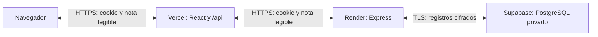
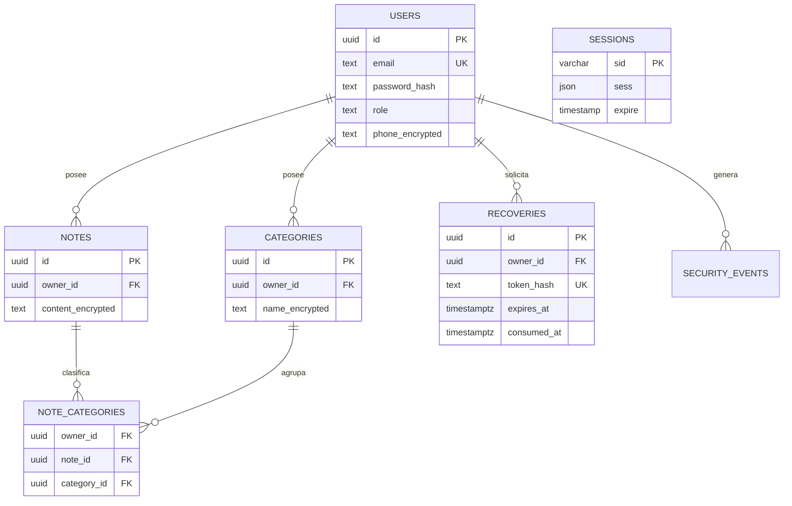

# Diseño y límites de acceso

Estado: primera implementación y pruebas locales sobre PostgreSQL temporal. El contrato describe las rutas implementadas; la validación de navegador, la topología y los servicios públicos siguen pendientes. Consultar `informe-seguridad.md` antes de desplegar.

Express autoriza al dueño y descifra el contenido para responder; por eso el diseño no es cifrado de extremo a extremo. La cookie no llega a PostgreSQL como cookie HTTP; el almacén guarda datos de sesión de servidor. La clave no llega al navegador. El administrador no debe recibir contenido de notas ni teléfonos completos.

`002_note_categories.sql` prepara categorías privadas y relaciones muchos a muchos con claves foráneas que exigen el mismo dueño para nota y categoría. Los nombres deben cifrarse con el formato de `crypto.js` antes de guardarlos. Estas tablas todavía no tienen rutas ni controles en React: la aplicación aún no permite crear ni asignar categorías desde la interfaz. Las claves foráneas garantizan coherencia de dueño en las asociaciones; las futuras rutas deberán autorizar y filtrar todas las operaciones por dueño.

Flujo previsto: obtener token CSRF ligado a una sesión anónima; registro sin aceptar rol; login con respuesta genérica y limitación compartida; regenerar ID de sesión y token CSRF; comprobar usuario, vigencia absoluta y permiso para cada petición; destruir y revocar la sesión al salir. En recuperación se envía el token por canal privado, se almacena solo su hash y la operación de consumo y revocación ocurre en transacción.

| Método y ruta prevista | Permiso | Entrada | Respuesta / errores |
|---|---|---|---|
| GET /api/auth/csrf | público | ninguna | token CSRF ligado a sesión |
| POST /api/auth/registro | público + CSRF | nombre, correo, contraseña | cuenta sin hash; 400/409 |
| POST /api/auth/login | público + CSRF | correo, contraseña | identidad y token renovado; 401/429 |
| GET /api/auth/me | sesión | ninguna | identidad; 401 |
| POST /api/auth/logout | sesión + CSRF | ninguna | confirmación; 401/403 |
| POST /api/auth/recuperar | público + CSRF | correo | respuesta genérica |
| POST /api/auth/restablecer | público + CSRF | token, contraseña | confirmación; 400 |
| GET/POST /api/notas | sesión; POST + CSRF | contenido para POST | notas propias o nueva nota; 400/401/403/429 |
| GET/PATCH/DELETE /api/notas/:id | sesión; escrituras + CSRF | id y contenido para PATCH | nota propia o confirmación; 404 tanto para ajena como inexistente |
| GET/PATCH /api/perfil | sesión; PATCH + CSRF | nombre y/o teléfono | teléfono enmascarado; 400/401/403 |
| GET /api/admin/usuarios y /api/admin/eventos | administrador | paginación limitada | campos explícitos; 401/403 |
| GET /health | público | ninguna | estado genérico; 503 si se comprueba base y falla |

| Activo | Amenaza | Control previsto | Prueba requerida | Riesgo restante |
|---|---|---|---|---|
| Nota de A | B cambia el ID | consulta por ID y dueño de sesión | B lee, modifica y borra: 404; fila intacta | compromiso de sesión de A |
| Sesión | fijación o robo | regeneración, cookie protegida, caducidades, revocación | cookie previa y cookie cerrada no autorizan | malware en el navegador |
| Escrituras | CSRF | token de sesión y origen exacto | petición sin token no modifica filas | XSS del mismo origen |
| Contraseña | fuerza bruta | Argon2id y límites por cuenta/red persistentes | contador preparado produce 429 y luego permite acceso | ataques distribuidos; bloqueo temporal abusivo |
| Base | lectura de respaldo | AES-GCM y TLS verificado | IV diferente y alteración rechazada; inspección saneada | Express y sus llaves pueden descifrar |
| Recuperación | token repetido | hash, vencimiento y consumo transaccional | dos solicitudes concurrentes: una sola gana | compromiso de correo |
| Servicio | agotamiento de notas | tamaño y cuota, bloqueo transaccional | creaciones concurrentes no exceden cuota | saturación de otros recursos |
| Registros | divulgación | campos explícitos sin secretos | inspección con datos ficticios | errores de configuración externa |

La prueba local comprueba aislamiento, CSRF, la cuota con concurrencia, el límite de login preparado, consumo simultáneo de un mismo token y cifrado. Quedan pendientes los demás ensayos de producción indicados en el informe. Para la demostración se usarán dos cuentas ficticias A y B y una cuenta administradora promovida por comando, sin contraseña administrativa predeterminada.
